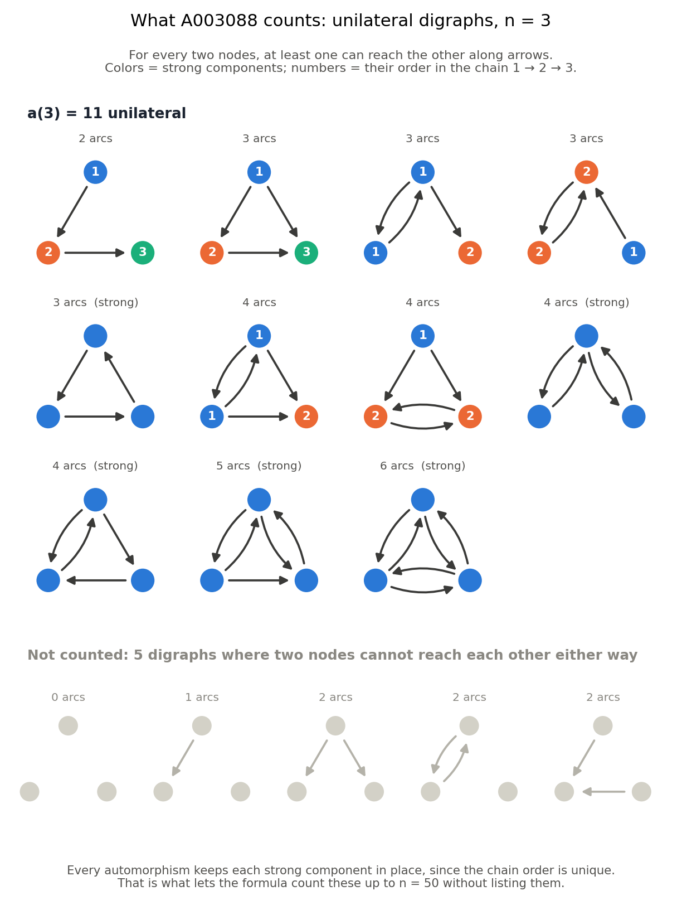
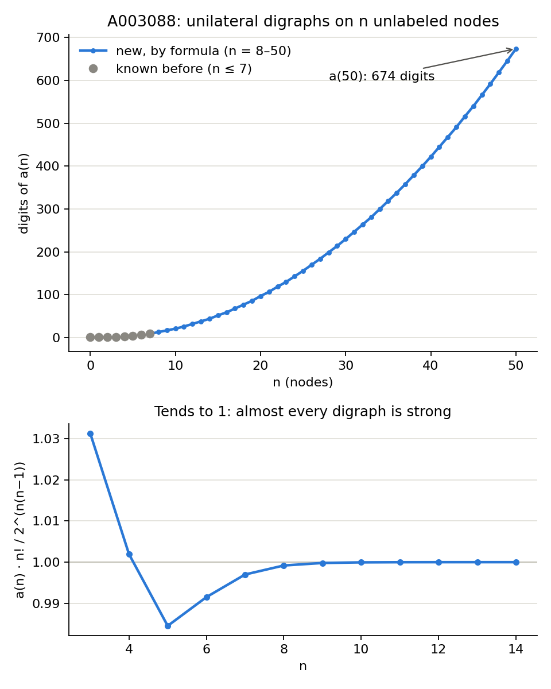

# A003088: unilateral digraphs on n unlabeled nodes

A digraph is **unilateral** (unilaterally connected) if for every two nodes u, v at least one of them can reach
the other by a directed path. **A003088(n)** counts them up to isomorphism. Harary and Palmer (Graphical
Enumeration, 1973, p. 218) give the problem; Read and Wilson's atlas has the small terms (with a wrong a(4));
a(7) = 870014637 was added by Sean A. Irvine in 2015. Nothing past a(7) was known.

**Result:** an exact counting formula by Burnside's lemma over chains of strong components. There is no
generation and no isomorphism testing. a(0)–a(22) take 11 seconds in Python; a C version run modulo 42
primes gives a(0)–a(50) (b003088.txt; a(50) has 674 digits). New terms start at

    a(8)  = 1785702274948
    a(9)  = 13011024809733902
    a(10) = 341126797327258866202

## What is being counted

Draw n dots and some one-way arrows between them (at most one arrow each way per pair, no loops). The drawing
is **unilateral** if for any two dots you can get from one to the other by following arrows, in at least one
direction. Drawings that differ only by relabelling the dots count once. Here are all 16 digraphs on 3 nodes;
11 of them are unilateral, so a(3) = 11:

Dots of one color can all reach each other (a **strong component**). In every unilateral digraph the
components line up in a single chain, numbered 1 → 2 → 3 in the picture, with arrows between components only
going forward and at least one arrow from each component to the next. In the grey row, some pair of dots
cannot reach each other either way: with arrows from the top dot to both bottom dots, for example, the two
bottom dots are stuck. Section 1 turns this picture into the counting formula.

The counts grow like 2^(n(n−1))/n! (the number of arrow patterns divided by the number of relabellings),
because almost every digraph is strongly connected, and strong digraphs are unilateral:

Both figures are made by `figures.py`.

## 1. Structure

Let C_1, ..., C_k be the strong components. Their condensation is acyclic, and a node of C_i reaches a node of
C_j only if C_i comes before C_j in every topological order. So the digraph is unilateral iff the condensation
has a Hamiltonian path, that is:

* the components can be ordered C_1 -> C_2 -> ... -> C_k with every arc between components going forward;
* there is at least one arc from C_i to C_{i+1} for each i (otherwise neither reaches the other: there is no
  component strictly between them to pass through);
* arcs from C_i to C_j with j > i + 1 are arbitrary.

The order is unique (a DAG with a Hamiltonian path has exactly one topological order). So **every
automorphism maps each strong component to itself**. That is what makes the count factor.

## 2. Formula

Burnside: a(n) = (1/n!) Σ_σ fix(σ), over σ in S_n. A σ-invariant unilateral digraph is a σ-invariant ordered
sequence of blocks B_1, ..., B_k (each a union of cycles of σ) with a σ-invariant strong digraph on each block
and σ-invariant forward arcs. For cycle types λ and μ of σ on two blocks, σ has g(λ, μ) = Σ_{a∈λ, b∈μ} gcd(a, b)
orbits on the arcs B_i × B_j. Collecting the n! / Π z_λi ways to choose σ and the blocks gives

    a(n) = Σ_{k≥0} Σ_{λ_1 + ... + λ_k ⊢ n}  Π_i s_{λ_i}  ·  Π_{i<j} 2^{g(λ_i, λ_j)}  ·  Π_{i<k} (1 − 2^{−g(λ_i, λ_{i+1})})

where s_λ is the coefficient of p_λ in the **cycle index of strong digraphs** Z_S (number of strong digraphs
fixed by a permutation of type λ, divided by z_λ). The last product forces at least one arc between consecutive
components. Because g is additive, 2^{g(earlier blocks, λ)} only needs the union of the earlier cycle types, so
the sum is a DP over states (union of earlier blocks, last block); a(22) needs 160k states.

### The cycle index of strong digraphs

Derived here from Robinson's source-component identity (R. W. Robinson, *Counting digraphs with restrictions on
the strong components*, 1995), in its Burnside form:

1. All digraphs: d_λ = 2^{g(λ,λ) − ℓ(λ)} / z_λ (σ has g(λ,λ) orbits on ordered pairs, ℓ(λ) of them loops).
2. For a σ-invariant digraph, Σ over σ-invariant sets T of source components of (−1)^{#σ-orbits on T} is
   Π_orbits (1 − 1) = 0 unless the digraph is empty. Splitting the nodes into U = ∪T and the rest gives
   E ⊙ D = 1, where (A ⊙ B)_ν = Σ_{λ+μ=ν} a_λ b_μ 2^{g(λ,μ)} (no arcs into U, any arcs out of U) and
   E = exp(−Σ_m Z_S[p_i → p_im] / m) is the signed series of sets of strong components.
3. So L = −log E = Σ_m Z_S[p_i → p_im] / m, and by Möbius inversion Z_S = Σ_m μ(m)/m · L[p_i → p_im].

All arithmetic is exact, modulo a Mersenne prime above 2^(n²) (2^521 − 1 for n ≤ 22), so the results are the
integers themselves.

## 3. Checks

* **A003088:** all 8 known terms reproduced (1, 1, 2, 11, 171, 8603, 1478644, 870014637); a(7) was computed
  independently by Irvine.
* **Strong digraphs:** Σ_λ s_λ reproduces Howroyd/Robinson's A035512 b-file for all of n = 0..50 (the C run
  outputs it alongside a(n)), and n!·s_{1^n} reproduces A003030 (labeled strong digraphs) for n ≤ 22.
* **Two implementations:** the C program reproduces the Python one for n ≤ 24, and a(0)–a(22) of the
  b-file computed by Python.
* **CRT:** a(n) < 2^(n(n−1)) (all digraphs), so 40 primes near 2^62 determine a(n) for n ≤ 50 with room
  to spare; the remaining 2 primes agree with the result for every n.
* **Labeled unilateral:** the identity-permutation part of the same DP reproduces the A003029 b-file to n = 22.
* **DP bookkeeping:** a direct term-by-term sum over block sequences (`direct()`) agrees with the DP for n ≤ 10.
* **Bounds:** a unilateral digraph is quasi-initially connected (A049512) and weakly connected (A003085); the new
  a(8)–a(10) lie just below both (a(10) = 3.41127e20 vs 3.41247e20).

## 4. Reproduce

    python unilateral.py 22     # prints A035512, A003030, A003029 checks and A003088 for n = 0..22

n = 22 takes 11 s in Python. For larger n, `unil.c` does the same computation modulo one prime:

    gcc -O2 -march=native -o unil unil.c
    bash run.sh 50 6            # unil 50 p for the 42 primes in primes.txt, 6 at a time -> results/n50_p*.txt
    python crt.py 50 40         # CRT over 40 primes, 2 check primes, A035512 and b-file checks

Each prime takes 6–8 minutes at n = 50 alone (25 minutes with 6 running at once). The cost is the chain DP:
481 million states (union of earlier blocks, last block) and about Σ over states of the number of partitions
that still fit. The cycle-index part takes seconds.

**Memory.** The states of the last few layers (|Q| + |λ| = s close to n) only matter through gcd(a, b) for
their parts a and the cycle lengths b ≤ n − s still to come, i.e. through the parts reduced to
lcm{d ≤ n − s : d | a}. Layer n is only summed, layers n−3 to n−1 are hash maps keyed by the reduced blocks
(1.5 million keys instead of 300 million states), and only layers ≤ n−4 are stored densely: 1.45 GB per
prime at n = 50 instead of 3.85 GB. Deeper layers compress too little to pay for a hash entry. Partitions are
looked up by an additive 64-bit hash (sum of a random word per part), checked collision-free at start-up.
